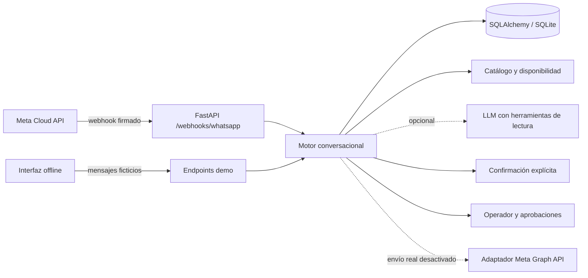

<div align="center">

# WhatsApp AI Agent 💬

**Agente de atención offline con FastAPI, herramientas controladas y citas ficticias.**

[🇺🇸 English](README.md) · [🇧🇷 Português](README.pt-BR.md) · [🇪🇸 Español](README.es.md)

[](https://github.com/RamonRDR/whatsapp-ai-agent/actions/workflows/ci.yml?query=branch%3Afeat%2Fwhatsapp-ai-agent-foundation) [](https://www.python.org/) [](https://www.python.org/) [](LICENSE)

[](https://fastapi.tiangolo.com/) [](https://docs.pydantic.dev/) [](https://docs.pydantic.dev/latest/concepts/pydantic_settings/) [](https://www.sqlalchemy.org/) [](https://www.sqlite.org/) [](https://alembic.sqlalchemy.org/) [](https://www.python-httpx.org/) [](https://www.uvicorn.org/)

[](Dockerfile) [](src/whatsapp_ai_agent/meta.py) [](src/whatsapp_ai_agent/llm.py) [](src/whatsapp_ai_agent/security.py) [](src/whatsapp_ai_agent/static/demo.html)

[](https://github.com/RamonRDR/whatsapp-ai-agent/actions/runs/42480937612) [](tests/test_integrations.py) [](.github/workflows/ci.yml) [](evals/scenarios.json) [](src/whatsapp_ai_agent/api.py) [](.github/workflows/ci.yml)

</div>

> **Estado del proyecto:** implementación de demostración en [PR #1 como borrador](https://github.com/RamonRDR/whatsapp-ai-agent/pull/1); sin merge ni despliegue. La API de Meta está implementada pero **probada solo con mocks**, sin validación en una cuenta real de WhatsApp Business. No se han enviado mensajes reales.

## Descripción general

WhatsApp AI Agent es una **demostración ficticia de soporte con funcionamiento offline por defecto**, desarrollada con FastAPI, conversaciones persistentes, consulta de servicios, solicitudes controladas de citas y transferencia a operadores. También contiene un **adaptador configurable de la API oficial Meta WhatsApp Cloud** y un **adaptador LLM opcional compatible con OpenAI y tool calling**. Ambos están **desactivados en la demostración predeterminada y en la CI obligatoria**.

El repositorio demuestra diseño backend con Python, integraciones HTTP, controles de IA aplicada, flujos con estado, seguridad de API, pruebas automatizadas y documentación internacional.

## Funcionalidades implementadas

- **Contrato oficial de webhooks:** desafío GET; comprobación POST HMAC-SHA256 sobre bytes originales; mensajes de entrada, eventos de estado y manejo de cargas desconocidas.
- **Procesamiento:** seudónimos de contactos, historial persistente, eliminación de duplicados, supresión de eventos fuera de orden, estados de entrega y auditoría de herramientas.
- **Conocimiento ficticio:** negocio, horarios, cancelación, FAQ y tres servicios de ejemplo con duración y precios en centavos.
- **Tool calling:** funciones de solo lectura permitidas, historial y argumentos limitados, manejo de errores del proveedor. El uso de un LLM real es opcional y requiere activación.
- **Citas demostrativas:** días laborables futuros, horario 09:00–17:00, intervalos de 30 minutos, bloqueos según la duración y `CONFIRM` o `NO` explícitos.
- **Intervención humana:** `HUMAN` suspende respuestas; consulta/reanudación administrativa; cancelación con token temporal de un solo uso.
- **Protecciones:** `STOP` para opt-out, límite de mensajes por contacto, límites de payload, clave de administración y envío real desactivado.
- **Interfaz offline:** chat HTML en `/demo` con historial, trazas de herramientas, errores y reinicio autenticado.
- **Calidad:** pytest, pytest-asyncio, Ruff lint/format, 24 escenarios deterministas ficticios, Alembic, paquete Python y comprobación de arranque Docker.

## Stack tecnológico

| Capa | Tecnología confirmada | Evidencia / alcance |
| --- | --- | --- |
| Lenguaje | Python 3.12+; CI ejecuta 3.12 y 3.14 | `pyproject.toml`, `ci.yml` |
| HTTP/API | FastAPI >=0.115, Uvicorn >=0.30, Pydantic v2, Pydantic Settings v2 | Intervalos declarados y código |
| Datos | SQLAlchemy 2.x, SQLite, Alembic >=1.13 | Modelos, migraciones, volumen Docker |
| Integraciones | httpx >=0.27; adaptador Meta Graph API | Transporte HTTP probado con mocks; envíos bloqueados |
| IA aplicada | Adaptador opcional compatible con OpenAI con seis funciones de solo lectura | `llm.py`; sin proveedor real en CI |
| Pruebas/calidad | pytest >=8, pytest-asyncio >=0.25, Ruff >=0.9 | Logs GitHub Actions; 32 correctas por versión |
| Infraestructura | Docker (Python 3.14 slim), GitHub Actions, paquete setuptools | Build, arranque/health y empaquetado |
| Documentación API | OpenAPI y Swagger UI | `/openapi.json` y `/docs` de FastAPI |

**Sin insignias de validación:** PostgreSQL es solo una opción de URL; este proyecto no instala su driver y CI utiliza SQLite. Hay configuración de `mypy` y dependencia `pytest-cov`, pero el workflow **no ejecuta type checking ni publica cobertura**. No se presentan como validados PostgreSQL, mypy o cobertura.

## Arquitectura



Los dos canales comparten el mismo motor. Transporte, almacenamiento, herramientas, aprobaciones e integración de salida están separados. **Un LLM no puede, por su propia respuesta, crear o cancelar una cita.** Consulta [arquitectura](docs/architecture.md), [seguridad](docs/security.md) y [decisiones técnicas](docs/decisions.md).

## Requisitos

- Python **3.12 o posterior** (3.12 y 3.14 probados en CI), pip y entorno virtual.
- Docker Engine opcional para la demostración en contenedor.
- **No se requiere** WhatsApp Business, token de Meta, API key del LLM, servicios de pago ni runner personal para las pruebas/demostración.
- SQLite predeterminado; PostgreSQL opcional requeriría instalar un driver compatible y validar esa configuración.

## Instalación local

```bash
git clone https://github.com/RamonRDR/whatsapp-ai-agent.git
cd whatsapp-ai-agent
# Mientras la PR #1 no se integre, usa la rama de desarrollo:
git switch feat/whatsapp-ai-agent-foundation
python -m venv .venv
source .venv/bin/activate
python -m pip install -e ".[dev]"
cp .env.example .env
alembic upgrade head
uvicorn whatsapp_ai_agent.api:app --host 127.0.0.1 --port 8000
```

En Windows PowerShell activa `.venv\Scripts\Activate.ps1` y utiliza `copy` en lugar de `cp`. Antes de que esta versión se integre en main, selecciona `git switch feat/whatsapp-ai-agent-foundation` antes de instalar.

## Configuración

Copia `.env.example` y usa **solo datos ficticios locales**. La mayoría de las opciones pueden conservar sus valores predeterminados.

| Variable | Valor predeterminado / finalidad |
| --- | --- |
| `DATABASE_URL` | `sqlite:///./whatsapp_agent.db`, SQLite local |
| `APP_ENV` / `DEMO_ENABLED` | `local` / `true`; demo desactivada fuera del modo local |
| `ADMIN_API_KEY` | Solo ejemplo local; utiliza una clave aleatoria fuerte, especialmente fuera del modo local |
| `WEBHOOK_VERIFY_TOKEN` | Token de desafío GET de Meta, vacío inicialmente |
| `META_APP_SECRET` | Secreto de validación POST sobre bytes originales, vacío inicialmente |
| `META_ACCESS_TOKEN` / `META_PHONE_NUMBER_ID` | Credenciales opcionales para envío oficial, vacías |
| `META_GRAPH_VERSION` | Ejemplo `v23.0`; confirma versión admitida en Meta |
| `ENABLE_REAL_SEND` | `false`; no activar sin autorización explícita |
| `LLM_PROVIDER` | `deterministic`, sin llamada a modelo real |
| `LLM_API_BASE` / `LLM_API_KEY` / `LLM_MODEL` | Proveedor LLM opcional; no habilitar en CI gratuita |
| `LLM_MAX_TOKENS` / `LLM_MAX_TOOL_CALLS` | `400` / `3`, ejecución controlada |
| `MESSAGE_RETENTION_DAYS` | `30`, para limpieza **manual** autenticada |
| `INBOUND_RATE_LIMIT` | `10` mensajes por contacto en una ventana local de un minuto |

Nunca incluyas secretos reales de `.env` en Git. Un despliegue de producción requiere revisión de seguridad adicional.

## Demostración offline y ejemplos

Con la aplicación ejecutándose localmente, abre **http://127.0.0.1:8000/demo** y **http://127.0.0.1:8000/docs**. La interfaz es un **simulador, no WhatsApp Web ni una cuenta real**. Ejemplos:

```text
services
hours
parking
availability YYYY-MM-DD
book consultation YYYY-MM-DD 10:00
CONFIRM
NO
HUMAN
STOP
```

Sustituye `YYYY-MM-DD` por un día laborable futuro dentro de los siguientes 60 días. La duración debe ajustarse al horario. El catálogo `Demo Studio` incluye `consultation`, `styling` y `followup`. Dirección y precios son ficticios.

Reinicia los datos ficticios mediante una solicitud autenticada:

```bash
curl -X POST http://127.0.0.1:8000/demo/reset -H "X-Admin-API-Key: YOUR_LOCAL_ADMIN_KEY"
```

## Referencia de la API

| Método | Endpoint | Finalidad |
| --- | --- | --- |
| GET | `/health` | Estado de la API y modo |
| GET | `/openapi.json`, `/docs` | Contrato OpenAPI e interfaz Swagger UI |
| GET | `/demo` | Simulador HTML offline (solo local) |
| POST | `/demo/message` | Procesar mensaje ficticio |
| GET | `/demo/history` | Historial y herramientas de un contacto de prueba |
| POST | `/demo/reset` | Restablecimiento autenticado |
| GET / POST | `/webhooks/whatsapp` | Verificar desafío Meta / recibir webhook firmado |
| GET | `/admin/handoffs` | Consultar transferencias abiertas |
| GET | `/admin/conversations/{id}` | Inspección administrativa de conversación |
| POST | `/admin/handoffs/{id}/resume` | Reanudar automatización autorizada |
| GET | `/admin/appointments` | Listar citas demostrativas |
| POST | `/admin/appointments/{id}/cancellation-approval` | Emitir aprobación temporal |
| POST | `/admin/appointments/{id}/cancel` | Consumir token en `X-Approval-Token` |
| POST | `/admin/purge-history` | Limpieza manual por retención |

Las rutas administrativas requieren `X-Admin-API-Key`. Los esquemas completos están en Swagger UI local, sin URL pública desplegada.

## Demostración Docker

```bash
docker build -t whatsapp-ai-agent .
docker run --rm -p 127.0.0.1:8000:8000 -v whatsapp-demo-data:/app/data whatsapp-ai-agent
```

El contenedor se ejecuta sin privilegios root, almacena SQLite en volumen escribible y sirve la demostración **local**. CI construye la imagen, la inicia y comprueba `/health`. **No publiques esta demo en Internet.**

## Adaptador oficial Meta Cloud API (opcional; probado con mocks)

`GET /webhooks/whatsapp` comprueba `hub.mode` y `hub.verify_token` antes de devolver `hub.challenge`. `POST` verifica `X-Hub-Signature-256` mediante HMAC-SHA256 y comparación segura de los **bytes originales**, y después procesa mensajes y estados. El envío oficial de texto utiliza httpx para `POST https://graph.facebook.com/{version}/{phone-number-id}/messages`.

El envío real requiere activación explícita, credenciales, ventana aplicable, consentimiento y cumplimiento de la [documentación Meta](https://whatsappbusiness.com/developers/developer-hub/). **No se ha registrado ningún webhook real ni validado la API Meta en producción.** No hay envío de plantillas aprobadas, campañas masivas ni automatización extraoficial de WhatsApp Web.

## LLM y herramientas (opcionales)

`LLM_PROVIDER=deterministic` es el valor inicial. El adaptador opcional `openai-compatible` de chat completions valida nombres, argumentos JSON, límites de llamadas y usa un prompt versionado. Las seis funciones **de solo lectura** son `list_services`, `get_service_details`, `get_business_hours`, `get_business_information`, `search_faq` y `get_availability`. Las escrituras y cancelaciones son deterministas o requieren un operador. **Los modelos externos no se llaman desde CI y pueden generar costos.**

## Pruebas automatizadas y evaluación

```bash
ruff check .
ruff format --check .
pytest -q
python -m evals.run
alembic upgrade head
docker build -t whatsapp-ai-agent .
```

**Evidencia:** [ejecución de PR #42480937612](https://github.com/RamonRDR/whatsapp-ai-agent/actions/runs/42480937612), 08/11/2026. Python 3.12: **32 correctas, 0 fallidas, 0 omitidas**; Python 3.14: **32 correctas, 0 fallidas, 0 omitidas**. Los logs mostraron advertencias, pero ninguna prueba falló. Los 24 escenarios ficticios deterministas pasaron; precisión observada de selección de herramientas del 100% para ese conjunto, cero solicitudes externas y US$ 0 de LLM. Son **resultados offline, no métricas de un LLM real**.

La insignia `pytest | 32 passing` es **estática y basada en esa ejecución**. Si cambia la suite, comprueba el resultado real de `pytest -q` en ambos Python y actualiza la misma insignia en los tres READMEs; no cuentes funciones manualmente. La insignia CI sigue la **rama de desarrollo** hasta un merge autorizado; después debes configurarla para `main`. No se emplean commits automáticos ni tokens adicionales.

## GitHub Actions

[`.github/workflows/ci.yml`](.github/workflows/ci.yml) usa runners alojados por GitHub, permisos mínimos de lectura y control de ejecuciones redundantes. Sus trabajos incluyen Ruff lint/format, pytest (3.12 y 3.14), evaluación offline, migraciones Alembic, build del paquete Python, build Docker, arranque del contenedor y prueba `/health`. No requiere runner personal, APIs de pago, mensajes reales ni deploy automático. **No ejecuta mypy ni publica cobertura.**

## Seguridad, privacidad y control humano

- Los webhooks inválidos se rechazan; los identificadores seudonimizados por HMAC y los límites de solicitudes/herramientas reducen el abuso.
- La clave administrativa protege inspección de conversaciones, reanudación, aprobaciones de cancelación y limpieza.
- `STOP` desactiva respuestas; `HUMAN` suspende automatización. Las citas exigen `CONFIRM` separado y las cancelaciones un token de uso único válido durante cinco minutos.
- Los logs evitan teléfonos y mensajes donde está previsto, pero **los cuerpos de conversación se almacenan como texto plano localmente**. Usa datos sintéticos y protege SQLite.
- `POST /admin/purge-history` aplica la limpieza **manual** según `MESSAGE_RETENTION_DAYS`; no existe servicio programado. Antes de usar datos reales se necesitan revisión LGPD/GDPR y autenticación apropiada.

Consulta los [detalles de seguridad](docs/security.md).

## Limitaciones conocidas

**No está listo para producción.** La integración Meta no está validada con una cuenta real; no existe despliegue, plantillas, cola saliente persistente, garantía de entrega exactamente una vez, limitación distribuida, proveedor de identidad de producción, panel completo de operadores, eliminación programada ni auditoría jurídica formal. CI valida SQLite, no PostgreSQL. Las citas son ficticias y no contemplan múltiples profesionales. El LLM opcional puede requerir adaptaciones según proveedor. No se afirman SLA, disponibilidad ni benchmarks reales.

## Estructura del proyecto

| Ruta | Responsabilidad |
| --- | --- |
| `src/whatsapp_ai_agent/api.py` | FastAPI, webhooks, demo y operadores |
| `src/whatsapp_ai_agent/agent.py` | Conversaciones y estados de confirmación |
| `src/whatsapp_ai_agent/catalog.py`, `availability.py` | Catálogo ficticio y horarios |
| `src/whatsapp_ai_agent/llm.py`, `meta.py` | Adaptadores opcionales de modelo y Meta |
| `src/whatsapp_ai_agent/models.py`, `database.py` | Entidades y sesiones persistentes |
| `src/whatsapp_ai_agent/security.py`, `telemetry.py` | Firmas, seudónimos y eventos estructurados |
| `src/whatsapp_ai_agent/static/demo.html` | Simulador HTML local |
| `src/whatsapp_ai_agent/prompts/system.txt` | Prompt del sistema versionado |
| `migrations/` | Revisiones Alembic |
| `tests/`, `evals/` | Pruebas y evaluación offline |
| `.github/workflows/ci.yml`, `Dockerfile` | Validación alojada y contenedor |

## Mejoras futuras (no implementadas)

Una futura versión de producción requeriría cola duradera y reintentos, política de consentimiento/plantillas, autenticación y roles de operadores, retención programada, pruebas PostgreSQL, límites distribuidos, sandbox Meta real, evaluación independiente de LLM y observabilidad adecuada. **Nada de esto se anuncia como completado.**

## Contribuciones

Se agradecen issues y comentarios técnicos. Trabaja en una rama y crea una pull request; no incluyas secretos ni datos personales reales. La versión actual está en [PR #1](https://github.com/RamonRDR/whatsapp-ai-agent/pull/1), pendiente de autorización expresa para Codex Review y merge.

## Licencia

[Licencia MIT](LICENSE), © 2026 Ramon Rodriguez.
