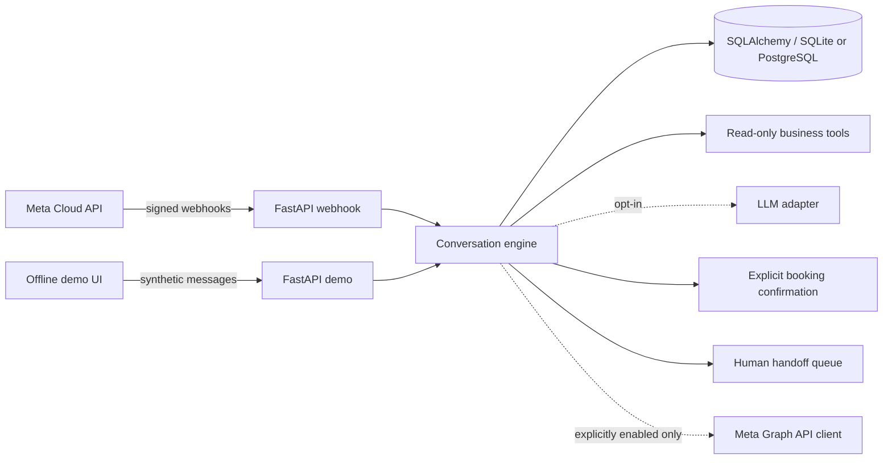

# WhatsApp AI Agent

[](https://github.com/RamonRDR/whatsapp-ai-agent/actions/workflows/ci.yml)

**Languages:** English (primary) | [Português](README.pt-BR.md) | [Español](README.es.md)

An offline-first WhatsApp-style customer support agent with a **real Meta WhatsApp Cloud API adapter**, FastAPI webhooks, structured SQL persistence, constrained tool calling, demo bookings, and human handoff. Designed as a portfolio demonstration of Python, backend engineering, integrations, applied AI, automation and defensive testing.

**Important:** the interactive demo is a local simulator, not a WhatsApp session. Meta credentials are not required for CI. Real message delivery is **off by default**. The Meta integration has been developed for the documented API contract and tested with mocks; **it has not been tested against a real Meta account**.

## Capabilities

- GET verification challenge and POST webhook HMAC-SHA256 verification over the **raw request bytes**.
- Inbound text-message ingestion, duplicate suppression, stale-event handling, and delivery-status recording.
- Official Graph API outbound text adapter using httpx with bounded timeouts and rate-limit handling. Requires explicit configuration and a valid customer-service window. Template sending is not implemented.
- SQLite persistence through SQLAlchemy 2 and Alembic, PostgreSQL URL support.
- Fictional business catalog; read-only tools: `list_services`, `get_service_details`, `get_business_hours`, `get_business_information`, `search_faq`, plus deterministic availability.
- Deterministic, credential-free default agent; optional OpenAI-compatible chat-completions adapter with validated **read-only** function calls. Never grants the LLM booking or cancellation permissions.
- Demonstration bookings with explicit CONFIRM, rejection, and unique-slot conflict protection.
- Opt-out, human handoff, and authenticated API endpoints for human resumption.
- Local HTML chat UI, message history and tool trace. No client data or real phone numbers in examples.
- Docker image, GitHub Actions (Python 3.12 and 3.14), pytest, Ruff, migrations and at least 20 fictional evaluation scenarios.

## Architecture



The same conversation engine processes demo and webhook messages. HTTP transport, tool execution, persistence and sending are separate. Write actions are deterministic, never executed on the model's assertion alone.

## Quick start

Requires Python 3.12+ (Python 3.14 is validated in CI when the workflow passes).

```bash
git clone https://github.com/RamonRDR/whatsapp-ai-agent.git
cd whatsapp-ai-agent
python -m venv .venv
source .venv/bin/activate  # Windows: .venv\\Scripts\\activate
python -m pip install -e ".[dev]"
cp .env.example .env     # Windows: copy .env.example .env
alembic upgrade head
uvicorn whatsapp_ai_agent.api:app --host 127.0.0.1 --port 8000
```

Open **http://127.0.0.1:8000/demo** for the fictional chat and **/docs** for OpenAPI. This app creates/initializes a local database at startup in local mode. For migrations as part of a deployment, use `alembic upgrade head`.

Example messages: `services`, `hours`, `parking`, `availability`, `book consultation YYYY-MM-DD 10:00`, `CONFIRM`, `NO`, `HUMAN`, `STOP`. Appointments are on fictional weekdays, 09:00 to 16:30, and must be in the next 60 days. Never use a real person's information in the demo.

Reset all demo contacts/messages and bookings, using a **local** admin key:

```bash
curl -X POST http://127.0.0.1:8000/demo/reset \\
  -H "X-Admin-API-Key: your-local-admin-key"
```

## Meta Cloud API contract (optional)

**Do not activate real sends without permission.** Set `WEBHOOK_VERIFY_TOKEN`, `META_APP_SECRET`, `META_ACCESS_TOKEN`, `META_PHONE_NUMBER_ID`, and check `META_GRAPH_VERSION` against your Meta app's supported version. Set `ENABLE_REAL_SEND=true` **only after** verifying your account, permissions, consent and policies. The separate `META_APP_SECRET` is required for signature validation. Webhook callback path: `/webhooks/whatsapp` (GET/POST). Public HTTPS hosting and webhook subscription are not performed by this repository.

GET: return the exact `hub.challenge` only for matching `hub.mode=subscribe` and verification token. POST: read raw bytes, compare `X-Hub-Signature-256` with constant-time HMAC-SHA256 and then process the `entry[].changes[].value.messages[]` array or delivery statuses. Status-only and unknown events are acknowledged without attempting conversation generation. Outgoing messages use `POST https://graph.facebook.com/{version}/{phone-number-id}/messages` with bearer authorization.

Free-text responses are restricted to the customer-service window; outside it, business messaging may require approved templates or other applicable Meta products/rules. This sample **does not send templates or campaigns**, and does not scrape WhatsApp Web. Refer to [Meta's official WhatsApp documentation](https://developers.facebook.com/documentation/business-messaging/whatsapp/overview) and [Meta's official Cloud API message collection](https://www.postman.com/meta/whatsapp-business-platform/).

## LLM and tools

The default `LLM_PROVIDER=deterministic` works fully offline. To enable a separate compatible model, configure `LLM_PROVIDER=openai-compatible`, `LLM_API_BASE`, `LLM_MODEL` and `LLM_API_KEY`. The adapter supports read-only tool calls with strict allowlists, JSON argument checks, bounded history and a maximum tool budget. Tool results, not free-text model claims, supply responses. **This opt-in mode may incur external cost**; it is never enabled in mandatory CI.

The business catalog is intentionally fictional: `Demo Studio`, a synthetic address, weekday hours, three fake services and sample prices in cents. Missing facts are never invented.

## Tests and evaluation

```bash
ruff check .
ruff format --check .
pytest -q
python -m evals.run
alembic upgrade head
docker build -t whatsapp-ai-agent .
```

GitHub Actions uses hosted runners only. It performs static checks, tests, migrations, packaging and Docker build without credentials or paid API access. Evaluation scenarios are under `evals/scenarios.json`; `evals/run.py` measures observed success/failure, tool-selection accuracy, and mean local request latency. Results are measured at run time, not claimed here.

## Security, privacy and operator controls

- Real traffic disabled by default; no production/demo mixing.
- Signed webhooks fail closed, bounded payloads, validated request schemas and administrative API key.
- Phone identifiers stored as keyed pseudonyms; note that **demo conversations are stored in plaintext locally**, so restrict access to the database.
- `STOP` suppresses future automation; `HUMAN` pauses automation; authenticated `/admin/handoffs` and `/admin/handoffs/{id}/resume` provide a minimal operator API.
- Explicit CONFIRM is consumed once, while cancellations are escalated for human authorization. The AI model can invoke **no write tools**.
- `MESSAGE_RETENTION_DAYS` is reserved for retention settings; automated retention enforcement is not yet implemented. Apply retention/privacy controls before using real customer data.

## Known limitations

This is a portfolio demo, **not production-ready WhatsApp infrastructure**. Integration is mock-tested only, not verified on a real Meta account; no deployed bot, public webhook subscription or real send has been performed. There is no durable outbound job queue, message-template approval/sending, per-tenant isolation, distributed rate limiter, production operator UI, production authentication provider, or GDPR/LGPD legal review. The simplified single-slot demo cannot serve overlapping durations professionally. The LLM opt-in may have provider-specific schema differences. No SLA, benchmark, delivery guarantee, or live integration is claimed.

Technical details and decisions: [docs/architecture.md](docs/architecture.md), [docs/security.md](docs/security.md), [docs/decisions.md](docs/decisions.md).

**License:** [MIT](LICENSE), © 2026 Ramon Rodriguez.
