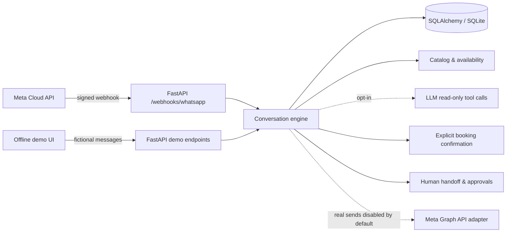

<div align="center">

# WhatsApp AI Agent 💬

**Offline-first WhatsApp support agent with FastAPI, guarded tool calling and fictional bookings.**

[🇺🇸 English](README.md) · [🇧🇷 Português](README.pt-BR.md) · [🇪🇸 Español](README.es.md)

[](https://github.com/RamonRDR/whatsapp-ai-agent/actions/workflows/ci.yml?query=branch%3Afeat%2Fwhatsapp-ai-agent-foundation) [](https://www.python.org/) [](https://www.python.org/) [](LICENSE)

[](https://fastapi.tiangolo.com/) [](https://docs.pydantic.dev/) [](https://docs.pydantic.dev/latest/concepts/pydantic_settings/) [](https://www.sqlalchemy.org/) [](https://www.sqlite.org/) [](https://alembic.sqlalchemy.org/) [](https://www.python-httpx.org/) [](https://www.uvicorn.org/)

[](Dockerfile) [](src/whatsapp_ai_agent/meta.py) [](src/whatsapp_ai_agent/llm.py) [](src/whatsapp_ai_agent/security.py) [](src/whatsapp_ai_agent/static/demo.html)

[](https://github.com/RamonRDR/whatsapp-ai-agent/actions/runs/42480937612) [](tests/test_integrations.py) [](.github/workflows/ci.yml) [](evals/scenarios.json) [](src/whatsapp_ai_agent/api.py) [](.github/workflows/ci.yml)

</div>

> **Project status:** Offline portfolio implementation on [draft PR #1](https://github.com/RamonRDR/whatsapp-ai-agent/pull/1); no merge or deployment. The Meta API is implemented but **tested with mocks only**, not with a real WhatsApp Business account. No real message has been sent.

## Overview

WhatsApp AI Agent is an **offline-first, fictional customer-support demonstration** built with FastAPI, persistent conversations, service lookups, guarded appointment requests, and operator handoff. It also includes a configurable **official Meta WhatsApp Cloud API adapter** and an **optional OpenAI-compatible LLM tool-calling adapter**. They are **not enabled in the default demo or mandatory CI**.

This repository illustrates Python backend design, HTTP integrations, applied AI guardrails, stateful workflows, API security, automated testing, and documentation for international engineering teams.

## Implemented features

- **Official webhook contract:** GET challenge verification; POST HMAC-SHA256 signature check over original bytes; inbound text and status events; unrecognized payload handling.
- **Message processing:** contact pseudonyms, persisted conversation history, deduplication, out-of-order event suppression, delivery status records and tool audit records.
- **Fictional knowledge:** business information, hours, cancellation information, FAQ, and three seeded services with duration and prices in cents.
- **Tool calling:** allowlisted, read-only calls to business and availability tools; bounded history/arguments and provider error handling. LLM use is strictly opt-in.
- **Demo bookings:** requests for future weekdays, 09:00–17:00 operating window, 30-minute granularity, duration-aware time locks, explicit `CONFIRM` or `NO`.
- **Human-in-the-loop:** `HUMAN` suspends automation; administrative view/resume; human cancellation requires a short-lived, single-use approval token.
- **Protection:** `STOP` opt-out, per-contact inbound throttling, webhook payload limits, admin API key, outbound sending disabled by default.
- **Offline interface:** a small HTML chat at `/demo` with history, tool trace, errors, and authenticated reset.
- **Quality:** pytest, pytest-asyncio, Ruff lint/format, 24 fictional deterministic scenarios, Alembic checks, package build and Docker startup smoke test.

## Technology stack

| Layer | Confirmed technology | Evidence / scope |
| --- | --- | --- |
| Runtime | Python 3.12+; CI exercises 3.12 and 3.14 | `pyproject.toml`, `ci.yml` |
| HTTP/API | FastAPI >=0.115, Uvicorn >=0.30, Pydantic v2, Pydantic Settings v2 | Declared version ranges and implementation |
| Data | SQLAlchemy 2.x, SQLite, Alembic >=1.13 | Models, migrations, local Docker volume |
| Integrations | httpx >=0.27; Meta Graph API adapter | HTTP transport mock-tested, real sends off |
| Applied AI | Optional OpenAI-compatible adapter with six read-only function schemas | `llm.py`; live model not exercised in CI |
| Tests/quality | pytest >=8, pytest-asyncio >=0.25, Ruff >=0.9 | GitHub Actions logs; 32 passed per Python version |
| Delivery | Docker (Python 3.14 slim), GitHub Actions, Python package via setuptools | Build, container health smoke test and package build |
| API docs | OpenAPI and Swagger UI | FastAPI `/openapi.json` and `/docs` |

**Not advertised as verified stack:** PostgreSQL is only a configurable database URL option; no PostgreSQL driver is installed by this project and CI uses SQLite. The `mypy` configuration and `pytest-cov` dependency exist, but the current CI does **not** run type checking or publish coverage metrics. No PostgreSQL, mypy, or coverage badge is claimed.

## Architecture



Both entry points share the conversation engine. Transport, database, business tools, approvals and outbound integration are separated. **An LLM response cannot itself create or cancel an appointment.** See [architecture](docs/architecture.md), [security](docs/security.md) and [design decisions](docs/decisions.md).

## Requirements

- Python **3.12 or later** (tested in CI on 3.12 and 3.14); pip and a virtual environment.
- Optional Docker Engine to run the local demo in a container.
- **No** WhatsApp Business account, Meta token, LLM API key, paid service or personal runner for the required demo/tests.
- SQLite is the default; optional PostgreSQL use requires a separately installed compatible driver and its own validation.

## Local installation

```bash
git clone https://github.com/RamonRDR/whatsapp-ai-agent.git
cd whatsapp-ai-agent
python -m venv .venv
source .venv/bin/activate
python -m pip install -e ".[dev]"
cp .env.example .env
alembic upgrade head
uvicorn whatsapp_ai_agent.api:app --host 127.0.0.1 --port 8000
```

On Windows PowerShell, activate with `.venv\Scripts\Activate.ps1` and replace `cp` with `copy`. For the unmerged implementation use the PR branch: `git switch feat/whatsapp-ai-agent-foundation` before installing.

## Configuration

Copy `.env.example` and use **fictional local data only**. Most settings can remain at their defaults.

| Variable | Default / purpose |
| --- | --- |
| `DATABASE_URL` | `sqlite:///./whatsapp_agent.db`, local SQLite |
| `APP_ENV` / `DEMO_ENABLED` | `local` / `true`; demo disabled outside local mode |
| `ADMIN_API_KEY` | Local example only; replace with a strong random value, especially outside local mode |
| `WEBHOOK_VERIFY_TOKEN` | Shared token for Meta's webhook GET challenge, blank by default |
| `META_APP_SECRET` | Secret for raw-body POST signature validation, blank by default |
| `META_ACCESS_TOKEN` / `META_PHONE_NUMBER_ID` | Optional official sending credentials, blank by default |
| `META_GRAPH_VERSION` | Example `v23.0`; confirm a supported version in your Meta account |
| `ENABLE_REAL_SEND` | `false`; must remain disabled without explicit authorization |
| `LLM_PROVIDER` | `deterministic`, no live model call |
| `LLM_API_BASE` / `LLM_API_KEY` / `LLM_MODEL` | Optional compatible LLM provider; do not enable for free CI |
| `LLM_MAX_TOKENS` / `LLM_MAX_TOOL_CALLS` | `400` / `3`, bounded LLM operation |
| `MESSAGE_RETENTION_DAYS` | `30`, for authenticated **manual** history purge |
| `INBOUND_RATE_LIMIT` | `10` per contact in the implemented local one-minute window |

Never commit actual `.env` secrets. Production deployment needs its own security review.

## Offline demo and examples

Open **http://127.0.0.1:8000/demo** and **http://127.0.0.1:8000/docs** after starting locally. The interface is a **simulator, not WhatsApp Web or a live account**. Use messages such as:

```text
services
hours
parking
availability 2027-01-11
book consultation YYYY-MM-DD 10:00
CONFIRM
NO
HUMAN
STOP
```

Replace `YYYY-MM-DD` with a valid future weekday within 60 days. Booking duration must fit the operating hours. The synthetic service catalog is `Demo Studio`, with example services such as `consultation`, `styling` and `followup`. All prices/addresses are fictional.

Reset fictional data with an authenticated request:

```bash
curl -X POST http://127.0.0.1:8000/demo/reset -H "X-Admin-API-Key: YOUR_LOCAL_ADMIN_KEY"
```

## API reference

| Method | Endpoint | Purpose |
| --- | --- | --- |
| GET | `/health` | API health and selected mode |
| GET | `/openapi.json`, `/docs` | OpenAPI contract and interactive Swagger UI |
| GET | `/demo` | Offline HTML simulator (local mode only) |
| POST | `/demo/message` | Process a fictional message |
| GET | `/demo/history` | Return fictional contact history and tool trace |
| POST | `/demo/reset` | Admin-authenticated demo reset |
| GET / POST | `/webhooks/whatsapp` | Meta challenge verification / signed webhook intake |
| GET | `/admin/handoffs` | Admin list of open operator handoffs |
| GET | `/admin/conversations/{id}` | Admin conversation inspection |
| POST | `/admin/handoffs/{id}/resume` | Admin-controlled automation resumption |
| GET | `/admin/appointments` | Admin list of demo bookings |
| POST | `/admin/appointments/{id}/cancellation-approval` | Issue expiring cancellation approval |
| POST | `/admin/appointments/{id}/cancel` | Consume approval using `X-Approval-Token` |
| POST | `/admin/purge-history` | Admin manual retention cleanup |

Admin routes require `X-Admin-API-Key`. Full request/response schemas are available in local Swagger UI, not at a public hosted URL.

## Docker demo

```bash
docker build -t whatsapp-ai-agent .
docker run --rm -p 127.0.0.1:8000:8000 -v whatsapp-demo-data:/app/data whatsapp-ai-agent
```

The container runs as a non-root user, stores SQLite in a writable named volume and exposes the **local** demo. CI builds the image, starts the container and checks `/health`. Do **not** publish the demo as an Internet-facing service.

## Official Meta Cloud API adapter (optional; mock-tested)

`GET /webhooks/whatsapp` checks `hub.mode` and `hub.verify_token` before returning `hub.challenge`. `POST` verifies `X-Hub-Signature-256` via constant-time HMAC-SHA256 over the **unchanged request bytes**, then processes supported message and status events. Outbound text uses `POST https://graph.facebook.com/{version}/{phone-number-id}/messages` via httpx.

Real sends require explicit enabling plus credentials, an eligible session window, user consent and compliance with current [Meta documentation](https://developers.facebook.com/docs/whatsapp/cloud-api/). **No real webhook has been registered and no live Meta API validation has been performed.** The sample does not implement approved template sending, mass marketing or unofficial WhatsApp Web automation.

## LLM and tools (optional)

`LLM_PROVIDER=deterministic` is the default. The optional `openai-compatible` chat-completions adapter validates tool names, JSON arguments and call count and uses a versioned prompt. The six allowlisted **read-only** functions are `list_services`, `get_service_details`, `get_business_hours`, `get_business_information`, `search_faq` and `get_availability`. Appointment writes and cancellation approval remain deterministic/human-controlled. **A real model call is not part of CI and may incur external charges.**

## Automated tests and evaluation

```bash
ruff check .
ruff format --check .
pytest -q
python -m evals.run
alembic upgrade head
docker build -t whatsapp-ai-agent .
```

**Verified source:** [GitHub Actions PR run #42480937612](https://github.com/RamonRDR/whatsapp-ai-agent/actions/runs/42480937612), 8 Nov 2026. Python 3.12: **32 passed, 0 failed, 0 skipped**; Python 3.14: **32 passed, 0 failed, 0 skipped**. Logs contained warnings but no test failures. The 24/24 fictitious deterministic evaluation scenarios passed; the measured tool-selection accuracy for that set was 100%, with zero external requests and $0 LLM cost. These are **offline results, not live-LLM performance claims**.

The `pytest | 32 passing` badge is **static and tied to this verified run**. When tests change, inspect the latest successful `pytest -q` results on both Python versions and update the same badge in all three READMEs; do not infer numbers from source files. The CI badge links to the **feature branch** while this PR remains unmerged; after an authorized merge, update it to track `main`. No auto-commits or special tokens are used.

## GitHub Actions

[`.github/workflows/ci.yml`](.github/workflows/ci.yml) uses GitHub-hosted runners, read-only repository permissions and concurrency control. Its jobs execute Ruff lint/format, pytest (3.12 and 3.14), offline deterministic evaluation, Alembic upgrade, package build, Docker build, container startup and health smoke test. No personal runner, paid API, real messaging or automatic deployment is required. **The workflow does not run mypy or publish coverage.**

## Security, privacy and operator controls

- Signed webhooks fail closed; sender IDs are HMAC-pseudonymized before persistence; request and tool limits reduce abuse.
- The admin API key controls operator conversation access, handoff resumption, cancellation approvals and manual retention operations.
- `STOP` disables automated replies; `HUMAN` pauses them. Booking needs a separate `CONFIRM`, and cancellation uses a five-minute, single-use approval token.
- Logs omit phone identifiers and message text where designed, but **stored conversation bodies are plaintext locally**. Use synthetic data and keep local database files private.
- `POST /admin/purge-history` performs a manual retention cleanup based on `MESSAGE_RETENTION_DAYS`; no scheduled purge service exists. Apply LGPD/GDPR review and production-grade authentication before use with personal data.

Read [security details](docs/security.md) for the scope of protections.

## Known limitations

**Not production-ready.** Real Meta integration is not verified against a WhatsApp account; no deployment, template approval/sending, durable outbound queue, exactly-once delivery guarantee, distributed throttling, production identity provider, full operator UI, scheduled data deletion or formal privacy/legal audit. SQLite is validated in CI; PostgreSQL integration is not. Demo appointments use fictional slots and no multi-professional capacity model. The optional LLM adapter may need provider-specific adaptation. No SLA, uptime or live-model benchmark is claimed.

## Project structure

| Path | Responsibility |
| --- | --- |
| `src/whatsapp_ai_agent/api.py` | FastAPI routes, webhook, demo, operator endpoints |
| `src/whatsapp_ai_agent/agent.py` | Conversation and confirmation state machine |
| `src/whatsapp_ai_agent/catalog.py`, `availability.py` | Fictional information and time slots |
| `src/whatsapp_ai_agent/llm.py`, `meta.py` | Optional model and Meta HTTP adapters |
| `src/whatsapp_ai_agent/models.py`, `database.py` | Persistent entities and sessions |
| `src/whatsapp_ai_agent/security.py`, `telemetry.py` | Signature checks, pseudonyms and structured events |
| `src/whatsapp_ai_agent/static/demo.html` | Browser-based local simulator |
| `src/whatsapp_ai_agent/prompts/system.txt` | Versioned agent system prompt |
| `migrations/` | Alembic revisions |
| `tests/`, `evals/` | Automated tests and offline evaluations |
| `.github/workflows/ci.yml`, `Dockerfile` | Hosted validation and container |

## Future improvements (not implemented)

If this demonstration were developed for production: durable outgoing message queue and retries, consent/template policy enforcement, authentication and operator roles, scheduled retention, PostgreSQL integration tests, stronger distributed rate limiting, live Meta sandbox validation, independently evaluated LLM quality and appropriate observability. These are **not** currently advertised as features.

## Contributions

Issues and technical feedback are welcome. Open a feature branch and propose a pull request; never include real secrets or personal customer data. The current implementation is under [PR #1](https://github.com/RamonRDR/whatsapp-ai-agent/pull/1), pending explicit authorization for Codex Review and merge.

## License

[MIT License](LICENSE), © 2026 Ramon Rodriguez.
