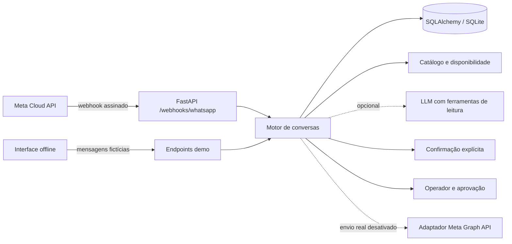

<div align="center">

# WhatsApp AI Agent 💬

**Agente de atendimento offline com FastAPI, ferramentas controladas e agendamentos fictícios.**

[🇺🇸 English](README.md) · [🇧🇷 Português](README.pt-BR.md) · [🇪🇸 Español](README.es.md)

[](https://github.com/RamonRDR/whatsapp-ai-agent/actions/workflows/ci.yml?query=branch%3Afeat%2Fwhatsapp-ai-agent-foundation) [](https://www.python.org/) [](https://www.python.org/) [](LICENSE)

[](https://fastapi.tiangolo.com/) [](https://docs.pydantic.dev/) [](https://docs.pydantic.dev/latest/concepts/pydantic_settings/) [](https://www.sqlalchemy.org/) [](https://www.sqlite.org/) [](https://alembic.sqlalchemy.org/) [](https://www.python-httpx.org/) [](https://www.uvicorn.org/)

[](Dockerfile) [](src/whatsapp_ai_agent/meta.py) [](src/whatsapp_ai_agent/llm.py) [](src/whatsapp_ai_agent/security.py) [](src/whatsapp_ai_agent/static/demo.html)

[](https://github.com/RamonRDR/whatsapp-ai-agent/actions/runs/42841876281) [](tests/test_integrations.py) [](.github/workflows/ci.yml) [](evals/scenarios.json) [](src/whatsapp_ai_agent/api.py) [](.github/workflows/ci.yml)

</div>

> **Status do projeto:** implementação demonstrativa na [PR #1 em draft](https://github.com/RamonRDR/whatsapp-ai-agent/pull/1); sem merge ou deploy. A API Meta está implementada, porém **testada apenas com mocks**, sem validação em uma conta WhatsApp Business real. Nenhuma mensagem real foi enviada.

## Visão geral

O WhatsApp AI Agent é uma **demonstração fictícia de atendimento, prioritariamente offline**, desenvolvida com FastAPI, conversas persistidas, consulta de serviços, solicitações controladas de agendamento e encaminhamento para operadores. Também inclui um **adaptador oficial configurável da Meta WhatsApp Cloud API** e um **adaptador LLM opcional compatível com OpenAI e tool calling**. Ambos permanecem **desativados na demonstração padrão e no CI obrigatório**.

O repositório demonstra backend Python, integrações HTTP, controles de IA aplicada, fluxos com estados, segurança de APIs, testes automatizados e documentação para equipes internacionais.

## Funcionalidades implementadas

- **Contrato oficial de webhook:** desafio GET; assinatura POST HMAC-SHA256 verificada sobre os bytes originais; mensagens recebidas, eventos de status e tratamento de payloads desconhecidos.
- **Processamento:** pseudônimos de contatos, histórico persistente, eliminação de duplicatas, supressão de eventos fora de ordem, status de entrega e trilhas de ferramentas.
- **Conhecimento fictício:** informações do negócio, horário, cancelamento, FAQ e três serviços de exemplo com duração e preços em centavos.
- **Tool calling:** ferramentas de leitura autorizadas, limite de histórico e argumentos, tratamento de indisponibilidade do provedor. Uso real de LLM é opcional e precisa ser ativado.
- **Agendamentos demonstrativos:** solicitações para dias úteis futuros, funcionamento das 09:00 às 17:00, intervalos de 30 minutos, bloqueios conforme duração e `CONFIRM` ou `NO` explícitos.
- **Aprovação humana:** `HUMAN` suspende automação; consulta/retomada administrativa; cancelamento depende de token temporário e de uso único.
- **Proteções:** opt-out `STOP`, limite de entrada por contato, limites de payload, chave administrativa e envio real desativado por padrão.
- **Interface offline:** chat HTML em `/demo` com histórico, rastreamento de ferramentas, erros e reinicialização autenticada.
- **Qualidade:** pytest, pytest-asyncio, Ruff lint/format, 24 cenários determinísticos fictícios, Alembic, empacotamento e teste de inicialização Docker.

## Stack tecnológica

| Camada | Tecnologia confirmada | Evidência / escopo |
| --- | --- | --- |
| Linguagem | Python 3.12+; CI executa 3.12 e 3.14 | `pyproject.toml`, `ci.yml` |
| HTTP/API | FastAPI >=0.115, Uvicorn >=0.30, Pydantic v2, Pydantic Settings v2 | Intervalos declarados e implementação |
| Persistência | SQLAlchemy 2.x, SQLite, Alembic >=1.13 | Modelos, migrações, volume local Docker |
| Integrações | httpx >=0.27; adaptador Meta Graph API | Transporte HTTP testado com mocks; envio real bloqueado |
| IA aplicada | Adaptador opcional compatível com OpenAI, com seis funções somente de leitura | `llm.py`; modelo externo não executado no CI |
| Testes/qualidade | pytest >=8, pytest-asyncio >=0.25, Ruff >=0.9 | Logs GitHub Actions; 38 aprovados em cada Python |
| Infraestrutura | Docker (Python 3.14 slim), GitHub Actions, pacote Python com setuptools | Build, inicialização/health e empacotamento |
| Docs API | OpenAPI e Swagger UI | `/openapi.json` e `/docs` do FastAPI |

**Sem badge de validação:** PostgreSQL é apenas uma opção de URL; o projeto não instala seu driver e o CI utiliza SQLite. Há configuração do `mypy` e dependência `pytest-cov`, porém o workflow atual **não executa verificação de tipos nem publica métricas de cobertura**. Não anunciamos PostgreSQL, mypy ou cobertura como validados.

## Arquitetura



Os dois pontos de entrada usam o mesmo motor. Transporte, banco, ferramentas, aprovações e integração de saída ficam separados. **Uma resposta de LLM não pode, sozinha, criar ou cancelar um agendamento.** Veja [arquitetura](docs/architecture.md), [segurança](docs/security.md) e [decisões técnicas](docs/decisions.md).

## Pré-requisitos

- Python **3.12 ou superior** (3.12 e 3.14 testados no CI), pip e ambiente virtual.
- Docker Engine opcional para a demonstração em contêiner.
- **Não são necessários** WhatsApp Business, token da Meta, chave LLM, serviços pagos nem runner pessoal para demonstração/testes.
- SQLite é o padrão. PostgreSQL opcional exigiria driver compatível instalado separadamente e validação própria.

## Instalação local

```bash
git clone https://github.com/RamonRDR/whatsapp-ai-agent.git
cd whatsapp-ai-agent
# Enquanto a PR #1 não for integrada, use a branch de desenvolvimento:
git switch feat/whatsapp-ai-agent-foundation
python -m venv .venv
source .venv/bin/activate
python -m pip install -e ".[dev]"
cp .env.example .env
alembic upgrade head
uvicorn whatsapp_ai_agent.api:app --host 127.0.0.1 --port 8000
```

No Windows PowerShell, ative com `.venv\Scripts\Activate.ps1` e substitua `cp` por `copy`. Enquanto a implementação não for integrada à main, selecione a branch `git switch feat/whatsapp-ai-agent-foundation` antes da instalação.

## Configuração

Copie `.env.example` e utilize **somente dados locais fictícios**. A maioria das opções pode permanecer no padrão.

| Variável | Padrão / finalidade |
| --- | --- |
| `DATABASE_URL` | `sqlite:///./whatsapp_agent.db`, SQLite local |
| `APP_ENV` / `DEMO_ENABLED` | `local` / `true`; demo desativada fora do modo local |
| `ADMIN_API_KEY` | Exemplo apenas local; use chave forte e aleatória, especialmente fora do modo local |
| `WEBHOOK_VERIFY_TOKEN` | Token para desafio GET da Meta, inicialmente vazio |
| `META_APP_SECRET` | Segredo de assinatura POST sobre corpo original, inicialmente vazio |
| `META_ACCESS_TOKEN` / `META_PHONE_NUMBER_ID` | Credenciais opcionais de envio oficial, inicialmente vazias |
| `META_GRAPH_VERSION` | Exemplo `v23.0`; confirme versão suportada em sua conta Meta |
| `ENABLE_REAL_SEND` | `false`; não ativar sem autorização explícita |
| `LLM_PROVIDER` | `deterministic`, sem chamada a modelo externo |
| `LLM_API_BASE` / `LLM_API_KEY` / `LLM_MODEL` | Provedor LLM opcional; não habilitar no CI gratuito |
| `LLM_MAX_TOKENS` / `LLM_MAX_TOOL_CALLS` | `400` / `3`, execução limitada |
| `MESSAGE_RETENTION_DAYS` | `30`, para limpeza **manual** autenticada |
| `INBOUND_RATE_LIMIT` | `10` mensagens por contato na janela local implementada de um minuto |

Nunca versione segredos reais de `.env`. Qualquer deploy de produção exige revisão de segurança adicional.

## Demonstração offline e exemplos

Com a aplicação local iniciada, abra **http://127.0.0.1:8000/demo** e **http://127.0.0.1:8000/docs**. A interface é um **simulador, não WhatsApp Web nem conta real**. Exemplos:

```text
services
hours
parking
availability YYYY-MM-DD
book consultation AAAA-MM-DD 10:00
CONFIRM
NO
HUMAN
STOP
```

Troque `AAAA-MM-DD` por um dia útil futuro em até 60 dias. A duração deve caber no expediente. O catálogo `Demo Studio` contém, por exemplo, `consultation`, `styling` e `followup`. Endereços e preços são totalmente fictícios.

Reinicialize os dados fictícios com autenticação:

```bash
curl -X POST http://127.0.0.1:8000/demo/reset -H "X-Admin-API-Key: YOUR_LOCAL_ADMIN_KEY"
```

## Referência da API

| Método | Endpoint | Objetivo |
| --- | --- | --- |
| GET | `/health` | Saúde da API e modo |
| GET | `/openapi.json`, `/docs` | Contrato OpenAPI e Swagger UI |
| GET | `/demo` | Simulador HTML offline (somente local) |
| POST | `/demo/message` | Processar mensagem fictícia |
| GET | `/demo/history` | Histórico e ferramentas do contato fictício |
| POST | `/demo/reset` | Reinicialização administrativa |
| GET / POST | `/webhooks/whatsapp` | Verificar desafio Meta / receber webhook assinado |
| GET | `/admin/handoffs` | Listar encaminhamentos abertos |
| GET | `/admin/conversations/{id}` | Consulta administrativa de conversa |
| POST | `/admin/handoffs/{id}/resume` | Retomar automação com autorização |
| GET | `/admin/appointments` | Listar agendamentos fictícios |
| POST | `/admin/appointments/{id}/cancellation-approval` | Gerar aprovação temporária |
| POST | `/admin/appointments/{id}/cancel` | Consumir token em `X-Approval-Token` |
| POST | `/admin/purge-history` | Limpeza manual autenticada por retenção |

As rotas administrativas exigem `X-Admin-API-Key`. Os schemas completos ficam no Swagger UI local, sem URL pública implantada.

## Docker demonstrativo

```bash
docker build -t whatsapp-ai-agent .
docker run --rm -p 127.0.0.1:8000:8000 -v whatsapp-demo-data:/app/data whatsapp-ai-agent
```

O contêiner executa sem privilégios de root, usa volume gravável SQLite e disponibiliza a demonstração **local**. O CI compila a imagem, inicia o contêiner e verifica `/health`. **Não exponha a demo publicamente na Internet.**

## Adaptador oficial Meta Cloud API (opcional; testado com mocks)

`GET /webhooks/whatsapp` verifica `hub.mode` e `hub.verify_token` antes de devolver `hub.challenge`. O `POST` verifica `X-Hub-Signature-256` por HMAC-SHA256 com comparação segura sobre **bytes originais**, depois trata eventos de mensagens e status. Para envio oficial de texto, o httpx utiliza `POST https://graph.facebook.com/{version}/{phone-number-id}/messages`.

Envio real exige ativação explícita, credenciais, janela aplicável, consentimento e cumprimento da [documentação da Meta](https://whatsappbusiness.com/developers/developer-hub/). **Nenhum webhook real foi cadastrado nem houve validação na API Meta real.** Não há envio por templates aprovados, campanhas em massa ou automação extraoficial do WhatsApp Web.

## LLM e ferramentas (opcionais)

`LLM_PROVIDER=deterministic` é o padrão. O adaptador `openai-compatible` opcional de chat completions valida funções, argumentos JSON, limite de chamadas e usa prompt versionado. As seis ferramentas **somente de leitura** são `list_services`, `get_service_details`, `get_business_hours`, `get_business_information`, `search_faq` e `get_availability`. Gravações e cancelamentos exigem regras determinísticas e aprovação humana. **Chamadas de modelo real não fazem parte do CI e podem ter custo.**

## Testes automatizados e avaliações

```bash
ruff check .
ruff format --check .
pytest -q
python -m evals.run
alembic upgrade head
docker build -t whatsapp-ai-agent .
```

**Evidência:** [execução PR #42841876281](https://github.com/RamonRDR/whatsapp-ai-agent/actions/runs/42841876281), 10/11/2026. Python 3.12: **38 aprovados, 0 falhas, 0 ignorados**; Python 3.14: **38 aprovados, 0 falhas, 0 ignorados**. Os logs registraram warnings, mas nenhum teste falhou. Os 24 cenários fictícios determinísticos passaram; taxa observada de seleção correta de ferramentas nesse conjunto de 100%, zero chamadas externas e US$ 0 em LLM. Esses números são **offline, não avaliação de um LLM real**.

O badge `pytest | 38 passing` é **estático, fundamentado nessa execução**. Se os testes mudarem, confira a execução mais recente de `pytest -q` nos dois Pythons e atualize o mesmo badge nos três READMEs; não conte funções manualmente. O badge de CI aponta para a **branch de desenvolvimento** enquanto a PR não for integrada; após merge autorizado, ajuste para `main`. Não há commits automáticos nem tokens especiais.

## GitHub Actions

O workflow [`.github/workflows/ci.yml`](.github/workflows/ci.yml) usa runners hospedados pelo GitHub, permissões mínimas de leitura e cancelamento de execuções redundantes. Executa Ruff lint/format, pytest (3.12 e 3.14), avaliação offline, Alembic, build do pacote Python, build Docker, inicialização do contêiner e teste `/health`. Dispensa runner pessoal, API paga, mensagens reais e deploy automático. **Não executa mypy nem publica cobertura.**

## Segurança, privacidade e controle humano

- Webhooks assinados são rejeitados quando inválidos; identificadores de origem são pseudonimizados por HMAC; limites de requisição e ferramentas reduzem abusos.
- A chave administrativa controla leitura de conversas, retomada de atendimento, aprovação de cancelamentos e limpeza de histórico.
- `STOP` desliga respostas; `HUMAN` pausa automação. Agendamento exige `CONFIRM` separado; cancelamento exige token único válido por cinco minutos.
- Logs evitam telefones e conteúdo de mensagens onde previsto, mas **as mensagens ficam em texto simples no banco local**. Use dados sintéticos e proteja os arquivos SQLite.
- `POST /admin/purge-history` faz limpeza **manual** segundo `MESSAGE_RETENTION_DAYS`; não há serviço de limpeza agendado. Antes de dados pessoais reais, é necessária avaliação LGPD/GDPR e autenticação de produção.

Detalhes em [segurança](docs/security.md).

## Limitações conhecidas

**Não é infraestrutura pronta para produção.** A integração Meta não foi validada em conta real; não há deploy, templates, fila durável de saída, garantia de entrega exatamente uma vez, rate limiting distribuído, provedor de identidade de produção, painel completo do operador, eliminação agendada nem revisão jurídica formal. SQLite é validado; PostgreSQL não. A agenda usa horários fictícios sem capacidade multi-profissional. O LLM opcional pode exigir adaptações ao provedor. Não há SLA, disponibilidade ou benchmark real declarados.

## Estrutura do projeto

| Caminho | Responsabilidade |
| --- | --- |
| `src/whatsapp_ai_agent/api.py` | Rotas FastAPI, webhook, demo, operadores |
| `src/whatsapp_ai_agent/agent.py` | Conversas e máquina de estados da confirmação |
| `src/whatsapp_ai_agent/catalog.py`, `availability.py` | Base fictícia e disponibilidade |
| `src/whatsapp_ai_agent/llm.py`, `meta.py` | Adaptadores opcionais de modelo e Meta |
| `src/whatsapp_ai_agent/models.py`, `database.py` | Entidades e sessões persistentes |
| `src/whatsapp_ai_agent/security.py`, `telemetry.py` | Assinatura, pseudônimos e eventos estruturados |
| `src/whatsapp_ai_agent/static/demo.html` | Simulador HTML local |
| `src/whatsapp_ai_agent/prompts/system.txt` | Prompt versionado |
| `migrations/` | Migrações Alembic |
| `tests/`, `evals/` | Testes e avaliações offline |
| `.github/workflows/ci.yml`, `Dockerfile` | Validação hospedada e contêiner |

## Evoluções futuras (não implementadas)

Em uma eventual versão de produção: fila durável e reenvios, política de consentimento/templates, autenticação e perfis de operadores, retenção agendada, testes PostgreSQL, limites distribuídos, validação no sandbox da Meta, avaliação independente da IA e observabilidade adequada. **Nada disso é anunciado como concluído.**

## Contribuições

Issues e contribuições técnicas são bem-vindas. Utilize branch de trabalho e pull request; não inclua credenciais ou dados de clientes. A implementação atual está na [PR #1](https://github.com/RamonRDR/whatsapp-ai-agent/pull/1), após a revisão inicial do Codex e as correções, aguardando nova revisão e autorização separada para merge.

## Licença

[Licença MIT](LICENSE), © 2026 Ramon Rodriguez.
